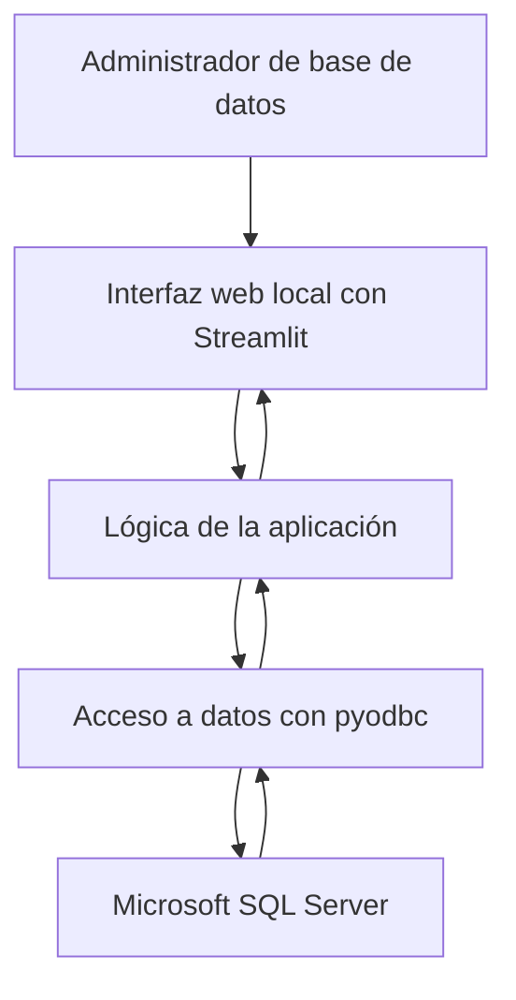

# Arquitectura de la solución

## Descripción general

El proyecto es una aplicación web local para el monitoreo, administración y auditoría de Microsoft SQL Server.

La aplicación utiliza Python y Streamlit para integrar los seis módulos requeridos dentro de una misma interfaz. La información se obtiene directamente desde SQL Server mediante consultas administrativas y se procesa antes de presentarse mediante indicadores, tablas y gráficos.

## Tecnologías seleccionadas

| Componente | Tecnología | Propósito |
|---|---|---|
| Sistema gestor de bases de datos | Microsoft SQL Server | Plataforma administrada y fuente real de información |
| Lenguaje | Python | Implementación de la aplicación y su lógica |
| Interfaz web local | Streamlit | Navegación, formularios, tablas, indicadores y gráficos |
| Conexión con el SGBD | `pyodbc` | Ejecución de consultas y operaciones sobre SQL Server |
| Visualización | Streamlit y Plotly | Presentación de métricas y gráficos |
| Control de versiones | GitHub | Código, scripts, documentación y evidencias |

## Diagrama general



## Separación de responsabilidades

### Capa de presentación

Implementada con Streamlit (`app/app.py`, `app/inicio.py` y `app/pages/`). Se encarga de:

- Mostrar el menú principal.
- Permitir la navegación entre los seis módulos.
- Presentar indicadores, tablas, filtros y gráficos.
- Solicitar confirmación antes de ejecutar operaciones administrativas.
- Mostrar mensajes de éxito, advertencia o error.

### Capa de lógica

Ubicada en `app/services/` y en las funciones de cada página. Se encarga de:

- Procesar los resultados obtenidos de SQL Server.
- Calcular métricas e indicadores.
- Aplicar validaciones.
- Preparar la información antes de mostrarla.
- Controlar las operaciones de mantenimiento.
- Evitar que la interfaz ejecute comandos arbitrarios.

### Capa de acceso a datos

Ubicada en `app/database/connection.py` y `app/database/queries/`. Se encarga de:

- Administrar la conexión con SQL Server.
- Ejecutar consultas administrativas.
- Ejecutar procedimientos u operaciones autorizadas.
- Entregar resultados estructurados a la capa de lógica.
- Capturar errores relacionados con conexión, permisos y ejecución.

### Sistema gestor de bases de datos

Microsoft SQL Server proporciona:

- Información de la instancia.
- Métricas de rendimiento.
- Información de almacenamiento.
- Historial de respaldos.
- Usuarios, roles y privilegios.
- Operaciones de mantenimiento preventivo.

## Módulos funcionales

La aplicación integra los siguientes módulos:

1. Estado general de la instancia.
2. Monitoreo de rendimiento.
3. Gestión del almacenamiento.
4. Respaldo y recuperación.
5. Auditoría.
6. Mantenimiento preventivo.

Todos los módulos están disponibles desde el menú principal de Streamlit (`st.navigation`).

## Conexiones y permisos

La solución diferencia entre:

- Una conexión consultiva (`adminsgbd_consulta`, `get_connection()`) con permisos de solo lectura para obtener información administrativa.
- Una conexión administrativa (`adminsgbd_mantenimiento`, `get_admin_connection()`, rol `db_ddladmin`) utilizada únicamente para las operaciones de mantenimiento del Módulo 6, después de una confirmación explícita.

Las credenciales reales no se almacenan en el código ni en el repositorio: viven en `config/.env`, excluido mediante `.gitignore`. El detalle de permisos está en el [manual técnico](../tecnica/manual-tecnico.md#5-modelo-de-seguridad-y-permisos).

## Ejecución

La aplicación se inicia localmente mediante:

```powershell
streamlit run app/app.py
```

Streamlit inicia un servidor web local y abre la interfaz en el navegador (`http://localhost:8501`). La aplicación se conecta a la instancia de SQL Server configurada en `config/.env`.

## Estado de la arquitectura

La arquitectura propuesta en la semana 1 se mantuvo durante todo el desarrollo. Los ajustes posteriores se documentaron en la bitácora: carpeta `app/services/` para la lógica del Módulo 3 (semana 5), conexión administrativa separada (semana 8) y menú con `st.navigation` (semana 9). La descripción detallada del código está en el [manual técnico](../tecnica/manual-tecnico.md).