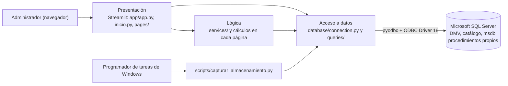

# Manual técnico

Este documento describe cómo está construida la aplicación: arquitectura, estructura del código, consultas y objetos de SQL Server, modelo de permisos y decisiones de diseño. Complementa al [manual de instalación](../manuales/instalacion.md) y al [manual de usuario](../manuales/usuario.md).

## 1. Arquitectura

| Capa | Ubicación | Responsabilidad |
|---|---|---|
| Presentación | `app/app.py`, `app/inicio.py`, `app/pages/` | Menú, tablas, indicadores, gráficos Plotly, filtros, confirmaciones y mensajes |
| Lógica | `app/services/`, funciones de cada página | Umbrales, porcentajes, interpretación de valores de SQL Server, validación de confirmaciones |
| Acceso a datos | `app/database/connection.py`, `app/database/queries/` | Conexiones, ejecución de consultas y procedimientos, conversión de filas a diccionarios |
| SGBD | Microsoft SQL Server | Fuente de toda la información; ejecuta las operaciones de mantenimiento |

La página no depende de `pyodbc`: las funciones de `queries/` devuelven listas de diccionarios. Cada módulo tiene su archivo de consultas en Python y su script equivalente en `sql/NN-modulo/` para poder probar las consultas en SSMS.

## 2. Estructura del código

| Archivo | Contenido |
|---|---|
| `app/app.py` | Configura la página y define el menú con `st.navigation` (Inicio + 6 módulos) |
| `app/inicio.py` | Prueba de conexión (servidor, base y usuario) y enlaces a los módulos |
| `app/database/connection.py` | `get_connection()` (consultiva) y `get_admin_connection()` (administrativa); leen `config/.env` y validan que no falten variables |
| `app/database/queries/estado_instancia.py` | Consultas del Módulo 1 |
| `app/database/queries/rendimiento.py` | Consultas del Módulo 2 |
| `app/database/queries/almacenamiento.py` | Consultas del Módulo 3 y llamada al procedimiento de captura |
| `app/services/almacenamiento.py` | Umbrales y cálculos del Módulo 3 (límite de archivos, disco, edición, crecimiento) |
| `app/database/queries/respaldos.py` | Historial de respaldos del Módulo 4 |
| `app/database/queries/auditoria.py` | Consultas del Módulo 5 |
| `app/database/queries/mantenimiento.py` | Detección (consultiva) y ejecución (administrativa) del Módulo 6 |
| `app/pages/1_...py` a `6_...py` | Una página por módulo |
| `scripts/capturar_almacenamiento.py` / `.bat` | Captura periódica del Módulo 3 desde el Programador de tareas |
| `test_connection.py`, `test_permissions.py` | Pruebas rápidas de conexión y permisos efectivos |

### Convenciones

- Cada sección de una página tiene su propio `try/except`: un fallo de permisos en una sección no oculta las demás.
- Un error se muestra con `st.error` + `st.exception`; un resultado vacío se muestra con `st.info` o `st.success`. Nunca se presenta un error como "sin resultados" (corrección D-11 de la semana 9).
- Las consultas de monitoreo se limitan con `TOP` (10 consultas, 20 sesiones, 20 respaldos, 10–30 objetos, 200 mediciones, 50 operaciones de mantenimiento).
- Las páginas siguen el mismo formato: título "Módulo N — Nombre", descripción, botón "Actualizar información" y hora de actualización.

## 3. Consultas por módulo

| Módulo | Vistas y funciones de SQL Server | Script de referencia |
|---|---|---|
| 1. Estado de la instancia | `@@SERVERNAME`, `SERVERPROPERTY`, `sys.dm_os_sys_info` (inicio y actividad), `sys.dm_os_process_memory`, `sys.databases` | `sql/01-estado-instancia/consultas_estado_instancia.sql` |
| 2. Rendimiento | `sys.dm_exec_query_stats` + `sys.dm_exec_sql_text` (TOP 10 por CPU), `sys.dm_exec_sessions` (TOP 20), `sys.dm_exec_requests` (`blocking_session_id <> 0`) | `sql/02-rendimiento/consultas_rendimiento.sql` |
| 3. Almacenamiento | `sys.database_files` + `FILEPROPERTY(..., 'SpaceUsed')`, `sys.filegroups`, `sys.dm_os_volume_stats`, `sys.dm_db_partition_stats` + `sys.objects`/`sys.indexes`, vista propia `monitoreo.vw_resumen_historial` | `sql/03-almacenamiento/consultas_almacenamiento.sql` |
| 4. Respaldos | `msdb.dbo.backupset`, `msdb.dbo.backupmediafamily` (filtrado por `DB_NAME()`) | `sql/04-respaldos/consultas_respaldos.sql` |
| 5. Auditoría | `sys.server_principals`, `sys.database_principals`, `sys.server_role_members`, `sys.database_role_members`, `sys.database_permissions`, `sys.sql_expression_dependencies` (`referenced_id IS NULL`) | `sql/05-auditoria/01_...` a `04_...` |
| 6. Mantenimiento | `sys.stats` + `sys.dm_db_stats_properties`, `sys.dm_db_index_physical_stats` (modo `LIMITED`), tabla propia `monitoreo.RegistroMantenimiento` | `sql/06-mantenimiento/consultas_mantenimiento.sql` |

Detalles relevantes:

- **Módulo 1:** el estado operativo se determina de forma implícita: si la consulta a `sys.dm_os_sys_info` responde, la instancia está en línea. La memoria es la del proceso `sqlservr.exe`.
- **Módulo 2:** `sys.dm_exec_query_stats` acumula desde el último inicio del servicio, por lo que en una instancia con poca actividad la lista puede estar dominada por consultas de SSMS.
- **Módulo 3:** `size` y `SpaceUsed` vienen en páginas de 8 KB (MB = páginas × 8 ÷ 1024). El límite de Express se calcula con `EngineEdition = 4` y `ProductMajorVersion` (10 GB hasta 2022, 50 GB desde 2025). La página verifica la conexión una sola vez al inicio.
- **Módulo 4:** la antigüedad se evalúa contra 24 horas. `is_damaged = 0` no garantiza que la copia sea restaurable.
- **Módulo 5:** la consulta de dependencias usa `referenced_id IS NULL` y excluye referencias a otras bases o servidores y referencias ambiguas, para evitar falsos positivos (corrección D-15).
- **Módulo 6:** la acción recomendada se calcula en la consulta: `REBUILD` desde 30 % de fragmentación y `REORGANIZE` desde 5 %; una estadística está desactualizada si cambió 20 % o más de sus filas.

## 4. Objetos creados por el proyecto

| Objeto | Script | Propósito |
|---|---|---|
| Base `BD_AdminSGBD` | `sql/00-configuracion/crear_base_pruebas.sql` | Base monitoreada y contenedora de los objetos propios |
| Esquema `monitoreo` | `sql/03-almacenamiento/01_...` | Tablas de registro y vistas del proyecto (dueño `dbo`) |
| Tabla `monitoreo.HistorialAlmacenamiento` | `sql/03-almacenamiento/01_...` | Una fila por archivo y por medición |
| Procedimiento `monitoreo.sp_capturar_almacenamiento` | `sql/03-almacenamiento/01_...` | Calcula y guarda una medición; rechaza valores NULL por permisos |
| Vista `monitoreo.vw_resumen_historial` | `sql/03-almacenamiento/01_...` | Una fila por medición (totales de datos y log) |
| Tabla `monitoreo.RegistroMantenimiento` | `sql/06-mantenimiento/02_...` | Fecha, operación, objeto, usuario, resultado y detalle de cada mantenimiento |
| Esquema `mantenimiento` | `sql/06-mantenimiento/03_...` | Procedimientos administrativos |
| `mantenimiento.sp_actualizar_estadisticas` | `sql/06-mantenimiento/03_...` | Valida la tabla, ejecuta `UPDATE STATISTICS ... WITH FULLSCAN` y registra éxito o fallo |
| `mantenimiento.sp_reconstruir_indice` | `sql/06-mantenimiento/03_...` | Valida tabla, índice y modo; ejecuta `ALTER INDEX ... REORGANIZE/REBUILD` y registra el resultado |

Los procedimientos de mantenimiento construyen el comando con `QUOTENAME` y solo aceptan los modos `REORGANIZE` o `REBUILD`, por lo que la aplicación no puede ejecutar SQL arbitrario.

Objetos de prueba (no forman parte de la solución): `dbo.PruebaBloqueo`, `prueba.CargaAlmacenamiento`, `dbo.vw_PruebaDependencia`, `dbo.PruebaMantenimiento`.

## 5. Modelo de seguridad y permisos

### Cuentas

| Cuenta | Tipo | Usada por | Permisos |
|---|---|---|---|
| `adminsgbd_consulta` | Login SQL + usuario en `BD_AdminSGBD` | Todos los módulos (lectura) y captura del Módulo 3 | Ver tabla siguiente |
| `adminsgbd_mantenimiento` | Login SQL + usuario en `BD_AdminSGBD` | Solo la ejecución del Módulo 6 | Rol `db_ddladmin` en `BD_AdminSGBD`; `EXECUTE` sobre los dos procedimientos de mantenimiento. No es `sysadmin` |

### Permisos de la cuenta consultiva

| Permiso | Ámbito | Script | Necesario para |
|---|---|---|---|
| `VIEW SERVER STATE` | Servidor | `01-estado-instancia/otorgar_...` | DMV de los módulos 1, 2, 3 y 6 (incluye `VIEW DATABASE STATE`) |
| `VIEW DEFINITION` | `BD_AdminSGBD` | `03-almacenamiento/02_...`, `06-mantenimiento/02_...` | Ver tablas e índices en el catálogo (visibilidad de metadatos) |
| `SELECT` sobre el esquema `monitoreo` | `BD_AdminSGBD` | `03-almacenamiento/02_...` | Leer los historiales |
| `EXECUTE` sobre `monitoreo.sp_capturar_almacenamiento` | `BD_AdminSGBD` | `03-almacenamiento/02_...` | Registrar mediciones sin `INSERT` directo |
| `VIEW ANY DEFINITION` | Servidor | `05-auditoria/00_...` | Ver todos los logins y roles de servidor |
| `SELECT` sobre `sys.sql_expression_dependencies` | `BD_AdminSGBD` | `05-auditoria/00_...` | Dependencias rotas |
| `VIEW DATABASE STATE`, `SELECT` sobre el esquema `dbo` | `BD_AdminSGBD` | `06-mantenimiento/02_...` | `sys.dm_db_stats_properties` exige `SELECT` sobre la tabla |

La lectura del historial de respaldos en `msdb` funciona con los permisos predeterminados de `msdb` (comprobado en la semana 6).

### Encadenamiento de propiedad

Las tablas de registro, los esquemas y los procedimientos pertenecen a `dbo`. Cuando una cuenta ejecuta un procedimiento con `EXECUTE`, SQL Server no vuelve a revisar permisos sobre las tablas del mismo dueño. Así, la cuenta consultiva puede registrar mediciones y la administrativa puede registrar operaciones **sin tener `INSERT`, `UPDATE` ni `DELETE` sobre las tablas de registro**, y sin poder insertar valores inventados, porque los valores los calcula el procedimiento.

### Credenciales

`config/.env` (ignorado por Git) es el único lugar con contraseñas. Los scripts que crean logins traen una contraseña de ejemplo que se cambia en SSMS sin guardar el archivo. Se revisó el historial completo del repositorio en la semana 10 y no contiene contraseñas reales.

## 6. Manejo de transacciones y errores

- `pyodbc` trabaja con `autocommit` desactivado. Las funciones que ejecutan procedimientos llaman a `commit()` explícitamente.
- En el Módulo 6 el `commit()` está en un bloque `finally`: si el procedimiento registra un fallo y luego lanza el error, el registro se conserva (corrección de la semana 8).
- Los procedimientos usan `THROW` con mensajes en español, que la página muestra tal cual.
- El Módulo 3 verifica la conexión una sola vez al inicio; si falla, muestra un único error en lugar de esperar el tiempo de conexión en cada sección.

## 7. Decisiones de diseño

| Decisión | Motivo |
|---|---|
| Microsoft SQL Server Express | Gratuito, disponible para todo el equipo y con DMV suficientes para los seis módulos |
| Python + Streamlit en lugar de Power BI | Integra consulta y mantenimiento en una sola interfaz; permite confirmaciones y manejo de errores |
| `pyodbc` + ODBC Driver 18 | Controlador oficial de Microsoft; acceso directo a DMV y procedimientos |
| Dos cuentas con permisos mínimos | Separar lectura de operaciones administrativas; ninguna cuenta es `sysadmin` |
| Escrituras solo mediante procedimientos | Encadenamiento de propiedad: menos permisos y registros confiables |
| Programador de tareas de Windows para la captura | SQL Server Agent no está disponible en Express (`Stopped`/`Disabled`) |
| Acción de índice calculada por la consulta | Evita que la persona usuaria elija una operación incorrecta |
| Confirmación obligatoria antes de ejecutar | Ninguna operación administrativa corre con un solo clic |
| `st.navigation` para el menú | Controla nombres y orden de las páginas |
| Umbrales del almacenamiento contra el tamaño máximo | Un archivo con autocrecimiento ilimitado casi lleno no es un riesgo real |

## 8. Pruebas

Las pruebas de integración de la semana 9 están en [`evidencias/semana-09/informe_pruebas.md`](../../evidencias/semana-09/informe_pruebas.md) (9 de 9 aprobadas) y la lista de defectos en [`lista_defectos.md`](../../evidencias/semana-09/lista_defectos.md). Cada semana dejó sus capturas y su archivo de continuidad en `evidencias/semana-NN/`.

## 9. Limitaciones conocidas

- Los módulos 3, 4 y 6 trabajan sobre la base de `DB_NAME`; el Módulo 6 solo cubre el esquema `dbo`.
- El Módulo 5 muestra los permisos de cada usuario o rol y los integrantes de cada rol en pestañas separadas; los permisos implícitos de los roles fijos no aparecen como filas.
- El historial de respaldos no detecta intentos fallidos que no llegaron a registrarse en `msdb`.
- `REBUILD` en Express no admite la opción `ONLINE`.
- Los textos internos del Módulo 6 ("Al dia", "Sin accion necesaria") no llevan tildes porque la lógica los compara.
